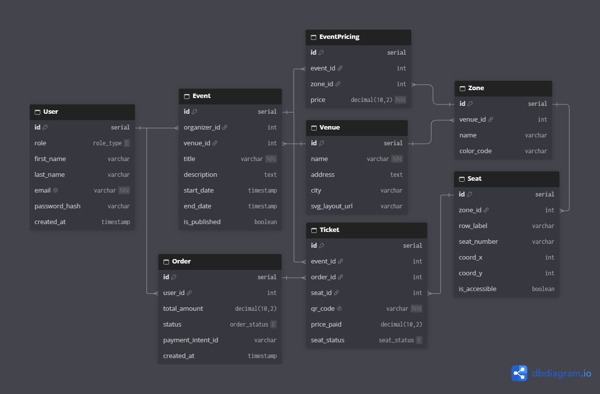

# Plataforma de Ticketing

### Requerimientos funcionales
<ol>
    <li>Iniciar Sesion</li>
    <ul>
        <li>Registrar Cuenta</li>
    </ul> 
    <li>Gestor de lugar (venues)</li>
    <ul>
        <li>Gestor de zonas</li>
        <li>Gestor de sillas</li>
    </ul>
    <li>Gestor de eventos (event)</li>
    <ul>
        <li>Gestor de precios por zona del evento</li>
    </ul>    
    <li>Ticketing</li>
    <ul>
        <li>Elegir evento</li>
        <li>Elegir sillas</li>
        <li>Elegir metodo de Pago</li>
    </ul> 
</ol>

### BDD

